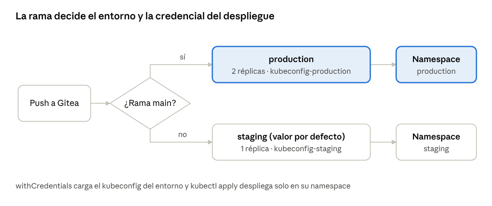

[← Sesión 6](sesion6.md) · [Índice de la UT02](./) · [Sesión 8 →](sesion8.md)

# Módulo 5168 Definición de flujos de procesos de despliegue continuo · Sesión 7 — Múltiples entornos y credenciales (Jenkins)

UT02, sesión 7 del módulo 5168: el mismo Jenkinsfile despliega en staging desde cualquier rama de feature y en production solo desde main, usando en cada caso su propia credencial.

## Ficha de la sesión

| Dato                   | Detalle                                                                                            |
|------------------------|----------------------------------------------------------------------------------------------------|
| Fecha y duración       | Jueves 3 de diciembre de 2026 · 2 h (30' teoría · 70' práctica · 20' de margen, descanso y repaso) |
| Criterio de evaluación | RA2.b (continuación de la sesión anterior); redacción oficial según tu programación                |
| Lugar y equipo         | Aula, VM de VirtualBox (.ova) de cada alumno con Docker, Gitea, Jenkins y Kubernetes               |
| Entregable             | Capturas y Jenkinsfile en el repositorio de Gitea del alumno, más un breve cuestionario en Aules   |

### Objetivos de aprendizaje

Al terminar la sesión, el alumnado será capaz de:

1.  Explicar por qué staging y production necesitan credenciales y parámetros distintos.

2.  Crear en Jenkins credenciales de tipo *Secret file* (kubeconfig) con un ID que identifique el entorno.

3.  Seleccionar en el Jenkinsfile el entorno según la rama (staging o production) y cargar la credencial correspondiente.

4.  Comprobar con dos ejecuciones (rama de feature y main) que cada una usa los parámetros de su entorno.

5.  Reconocer qué malas prácticas filtran secretos en los logs.

### Requisitos previos

- Jenkins operativo en la VM, con los plugins **Pipeline**, **Credentials Binding** y el de **Gitea** (o Git) para el *branch source*.

- Un job de tipo **Multibranch Pipeline** apuntando al repositorio de Gitea. Es imprescindible: la condición when { branch 'main' } solo funciona en este tipo de job, porque en un Pipeline simple la variable BRANCH_NAME no existe.

- Acceso desde Jenkins al clúster de Kubernetes de la VM (kubectl instalado en el agente o ejecución dentro de un contenedor que lo incluya).

- Una aplicación sencilla ya desplegable (la de sesiones anteriores) con su manifiesto en k8s/.

### Preparación del profesor (antes de clase)

- Comprobar que el repositorio de ejemplo tiene dos ramas: main y feature/saludo (o similar), y que el job Multibranch las detecta con *Scan Repository Now*.

- Tener a mano el script prep-entornos.sh (se detalla en la práctica) para que los 10 primeros minutos no se pierdan en teclear comandos de Kubernetes.

- Probar la sesión completa en una VM limpia: el tiempo real de la práctica depende de que el clúster responda con fluidez.

## Teoría ampliada (30')

Idea clave para el alumnado: **el código de la aplicación no cambia entre entornos; cambian el destino y las credenciales para llegar a él**, y el pipeline debe elegirlos solo, sin que nadie edite el Jenkinsfile a mano.

### Guión de tiempos

| Minutos | Bloque                          | Qué se hace                                                       |
|---------|---------------------------------|-------------------------------------------------------------------|
| 0–5     | Qué es un entorno               | Pregunta inicial y ejemplo de un despliegue desastroso            |
| 5–12    | Qué cambia entre entornos       | Tabla de parámetros y principio de configuración fuera del código |
| 12–22   | Credenciales en Jenkins         | Tipos, ámbitos, ID y enlace al pipeline                           |
| 22–28   | Elegir el entorno según la rama | Ejemplo del Jenkinsfile y variantes                               |
| 28–30   | Cierre                          | Errores típicos y preguntas                                       |

### 1. Qué es un entorno de despliegue (5')

Un entorno es un destino donde se ejecuta la aplicación con una configuración propia. Los más habituales son tres:

- **Desarrollo**: máquina del programador o entorno compartido de pruebas rápidas; se rompe a menudo y no importa.

- **Staging** (preproducción): copia lo más fiel posible de producción donde se valida la versión antes de publicarla.

- **Production**: lo que usan los usuarios reales; un error aquí tiene coste real.

Pregunta para abrir debate: *¿qué pasaría si una rama de feature a medio hacer se desplegara en producción porque alguien se equivocó de contexto de kubectl?* De ahí sale la motivación: el pipeline, y no la persona, decide el destino.

### 2. Qué cambia de un entorno a otro (7')

| Elemento                      | Staging                                    | Production                                              |
|-------------------------------|--------------------------------------------|---------------------------------------------------------|
| Destino en Kubernetes         | Namespace o clúster staging                | Namespace o clúster production                          |
| Credencial de acceso          | kubeconfig con permisos solo sobre staging | kubeconfig distinto, con permisos solo sobre production |
| Número de réplicas y recursos | Pocos, ajustados                           | Los necesarios para la carga real                       |
| Datos y servicios externos    | Base de datos y claves de pruebas          | Base de datos y claves reales                           |
| Quién puede desplegar         | Cualquier rama validada                    | Solo main, con más controles                            |

Tres ideas que conviene dejar claras:

1.  **Misma imagen, distinta configuración.** La imagen que se probó en staging es la que se promociona; lo que cambia es la configuración inyectada (variables, ConfigMap, Secret).

2.  **Credenciales separadas por entorno.** Si staging y production comparten credencial, un fallo en una rama de feature puede tocar producción. Con credenciales distintas, el propio sistema impide el error.

3.  **Configuración fuera del código.** Ningún secreto vive en el repositorio ni en el Jenkinsfile: viven en Jenkins (o en un gestor de secretos) y el Jenkinsfile solo los referencia por su ID.

### 3. Gestión de credenciales en Jenkins (10')

El **Credentials Store** de Jenkins guarda secretos cifrados. Se gestionan en *Manage Jenkins → Credentials*. Cada credencial tiene un **ID** (el nombre con el que el pipeline la referencia), una descripción y un ámbito.

Tipos más usados:

| Tipo                          | Para qué sirve                                                          | Ejemplo en este módulo                    |
|-------------------------------|-------------------------------------------------------------------------|-------------------------------------------|
| Username with password        | Usuario y contraseña                                                    | Registro de imágenes, acceso a Gitea      |
| Secret text                   | Un único valor (token, clave de API)                                    | Token de un servicio                      |
| **Secret file**               | Un fichero completo, que Jenkins entrega al pipeline como ruta temporal | **kubeconfig de staging y de production** |
| SSH Username with private key | Acceso por SSH                                                          | Despliegue en un servidor remoto          |
| Certificate                   | Certificado cliente                                                     | Acceso a un clúster que lo exija          |

**Ámbito (scope).** *Global* hace la credencial visible para todos los jobs; *System* la reserva para Jenkins mismo. Además, una credencial creada dentro de una **carpeta** solo la ven los jobs de esa carpeta: es la forma de que los pipelines de staging no puedan ni listar las credenciales de producción. En la práctica de hoy se usa el ámbito Global por sencillez, y se menciona la carpeta como mejora.

**Convención de nombres.** Un ID que lleve el entorno al final permite construirlo en el pipeline: kubeconfig-staging y kubeconfig-production. El ID no se puede cambiar después sin romper los Jenkinsfile que lo usan.

**Cómo llega la credencial al pipeline.** Hay dos formas, y conviene mostrar ambas:

```groovy
// Forma 1: directiva credentials() dentro de environment (ID literal)
environment {
    REGISTRY = credentials('registro-docker')   // crea REGISTRY, REGISTRY_USR y REGISTRY_PSW
}

// Forma 2: withCredentials, válida con un ID calculado en tiempo de ejecución
withCredentials([file(credentialsId: "kubeconfig-${env.TARGET_ENV}", variable: 'KUBECONFIG')]) {
    sh 'kubectl get pods'
}
```

Para elegir la credencial según el entorno se usa la forma 2, porque su credentialsId admite una cadena construida con TARGET_ENV. Fuera del bloque withCredentials, la variable KUBECONFIG no existe y el fichero temporal se borra.

**Protección en los logs.** Jenkins sustituye por \*\*\*\* el valor exacto de un secreto si aparece en la salida. No es una garantía absoluta: si el valor se transforma (por ejemplo, en base64) o se parte, ya no se enmascara. Por eso hay reglas:

- No imprimir secretos con echo ni con cat del fichero.

- Usar comillas simples en sh '...' para que sea el shell quien lea la variable, y no Groovy quien la interpole en el texto del comando.

- No activar set -x en scripts que manejan secretos.

### 4. Elegir el entorno según la rama (6')

En un job **Multibranch**, Jenkins crea un pipeline por cada rama y define BRANCH_NAME. Sobre esa variable se apoya la condición when { branch 'main' }.



selección de entorno por rama · 1 decisión, 2 destinos

Una rama distinta de main sigue el camino de staging, que es el valor por defecto; solo main cambia a production y, con ello, a su credencial y a sus parámetros.

```groovy
pipeline {
    agent any
    environment {
        TARGET_ENV = "staging"          // valor por defecto: cualquier rama va a staging
    }
    stages {
        stage('Seleccionar entorno') {
            when { branch 'main' }
            steps { script { env.TARGET_ENV = "production" } }
        }
        stage('Desplegar') {
            steps {
                withCredentials([file(credentialsId: "kubeconfig-${env.TARGET_ENV}", variable: 'KUBECONFIG')]) {
                    sh 'kubectl apply -f k8s/ -n ${TARGET_ENV}'
                }
            }
        }
    }
}
```

Puntos a explicar sobre este código:

- El valor por defecto es el seguro: si algo falla al evaluar la rama, se queda en staging, nunca en production.

- Asignar a env.TARGET_ENV dentro de script modifica la variable de entorno para **todas las etapas siguientes**; una variable Groovy normal (def x) no sobrevive entre etapas.

- La etapa Seleccionar entorno se omite (aparece en gris) en las ramas que no son main.

Variante equivalente y más corta, para comentar al final:

```groovy
environment {
    TARGET_ENV = "${env.BRANCH_NAME == 'main' ? 'production' : 'staging'}"
}
```

Ambas hacen lo mismo. La primera muestra con claridad el uso de when; la segunda concentra la decisión en una línea.

### 5. Cierre y errores típicos (2')

- Usar un job Pipeline normal en lugar de Multibranch: when { branch } nunca se cumple.

- ID de credencial mal escrito: el pipeline falla con un error de credencial no encontrada, aunque exista otra parecida.

- Dejar el kubeconfig de producción con permisos de administrador del clúster completo.

- Escribir el secreto directamente en el Jenkinsfile "solo para probar" y subirlo a Gitea.

## Práctica guiada (70')

El alumnado termina con un solo Jenkinsfile que despliega en staging desde una rama de feature y en production desde main, cada vez con su propio kubeconfig.

| Minutos | Paso                                        | Resultado                                              |
|---------|---------------------------------------------|--------------------------------------------------------|
| 0–10    | 0\. Preparar los dos entornos en Kubernetes | Dos namespaces y dos kubeconfig con permisos distintos |
| 10–25   | 1\. Crear las credenciales en Jenkins       | kubeconfig-staging y kubeconfig-production             |
| 25–35   | 2\. Preparar el repositorio                 | Manifiesto en k8s/ y rama de feature                   |
| 35–50   | 3\. Escribir el Jenkinsfile                 | Pipeline que elige entorno y credencial                |
| 50–65   | 4\. Probar en feature y en main             | Un despliegue en cada namespace                        |
| 65–70   | 5\. Experimento de aislamiento              | Prueba de que la credencial protege producción         |

### Paso 0 · Preparar los entornos en Kubernetes (10')

El profesor entrega el script prep-entornos.sh; el alumnado lo ejecuta y después comprueba qué ha creado. Genera, para cada entorno, un namespace, una cuenta de servicio jenkins-deployer con permisos únicamente sobre ese namespace y un fichero kubeconfig que usa el *token* de esa cuenta.

```bash
#!/usr/bin/env bash
# Uso: ./prep-entornos.sh https://DIRECCION-DEL-API:6443
# La dirección debe ser alcanzable desde Jenkins (no vale 127.0.0.1 si Jenkins corre en un contenedor).
set -euo pipefail
SERVER="${1:?indica la URL del API server}"
CA=$(kubectl config view --raw --minify -o jsonpath='{.clusters[0].cluster.certificate-authority-data}')

for ENTORNO in staging production; do
  kubectl create namespace "$ENTORNO" --dry-run=client -o yaml | kubectl apply -f -
  kubectl -n "$ENTORNO" create serviceaccount jenkins-deployer --dry-run=client -o yaml | kubectl apply -f -
  kubectl -n "$ENTORNO" create role deployer \
      --verb=get,list,watch,create,update,patch,delete \
      --resource=deployments.apps,services,configmaps,pods --dry-run=client -o yaml | kubectl apply -f -
  kubectl -n "$ENTORNO" create rolebinding deployer --role=deployer \
      --serviceaccount="$ENTORNO:jenkins-deployer" --dry-run=client -o yaml | kubectl apply -f -

  TOKEN=$(kubectl -n "$ENTORNO" create token jenkins-deployer --duration=720h)
  cat > "kubeconfig-$ENTORNO" <<EOF
apiVersion: v1
kind: Config
clusters:
- name: laboratorio
  cluster:
    server: $SERVER
    certificate-authority-data: $CA
users:
- name: jenkins-deployer-$ENTORNO
  user:
    token: $TOKEN
contexts:
- name: $ENTORNO
  context:
    cluster: laboratorio
    user: jenkins-deployer-$ENTORNO
    namespace: $ENTORNO
current-context: $ENTORNO
EOF
  echo "Creado kubeconfig-$ENTORNO"
done
```

**Comprobación obligatoria** antes de seguir. Cada credencial debe funcionar en su entorno y ser rechazada en el otro:

```bash
kubectl --kubeconfig kubeconfig-staging -n staging get pods        # correcto (lista vacía)
kubectl --kubeconfig kubeconfig-staging -n production get pods     # Error: Forbidden
```

Si la segunda orden devuelve Forbidden, la separación de permisos funciona. Esta comprobación es la base de todo lo que sigue.

> Plan B si Kubernetes da problemas de red o de certificados: usar el mismo kubeconfig de administrador copiado dos veces y distinguir los entornos solo por el namespace. La práctica de Jenkins funciona igual, pero se pierde el experimento de aislamiento del paso 5.

### Paso 1 · Crear las credenciales en Jenkins (15')

Hay que repetir el proceso dos veces, una por entorno:

1.  *Manage Jenkins → Credentials → System → Global credentials (unrestricted) → Add Credentials*.

2.  **Kind**: Secret file.

3.  **File**: seleccionar kubeconfig-staging (después, kubeconfig-production).

4.  **ID**: kubeconfig-staging (después, kubeconfig-production). Debe escribirse exactamente igual en el Jenkinsfile.

5.  **Description**: "Acceso al namespace staging" (después, "Acceso al namespace production").

6.  Guardar con *Create*.

Cuando estén creadas, borrar de la VM los dos ficheros kubeconfig o dejarlos fuera de cualquier repositorio: contienen tokens válidos. Jenkins ya guarda su propia copia cifrada.

### Paso 2 · Preparar el repositorio (10')

En el repositorio de Gitea, rama main, comprobar que existe k8s/web.yaml. Si el alumnado no conserva uno de sesiones anteriores, sirve este:

```yaml
apiVersion: apps/v1
kind: Deployment
metadata:
  name: web
spec:
  replicas: 1
  selector:
    matchLabels: {app: web}
  template:
    metadata:
      labels: {app: web}
    spec:
      containers:
      - name: web
        image: nginx:alpine
        ports:
        - containerPort: 80
---
apiVersion: v1
kind: Service
metadata:
  name: web
spec:
  selector: {app: web}
  ports:
  - port: 80
```

El manifiesto **no incluye namespace**: lo pone el pipeline con -n. Así el mismo fichero sirve para los dos entornos.

Después, crear la rama de trabajo y subirla:

```bash
git switch -c feature/saludo
git push -u origin feature/saludo
```

En el job Multibranch de Jenkins, pulsar *Scan Repository Now* para que detecte las dos ramas (main y feature/saludo). Todavía no hay Jenkinsfile con esta lógica, así que no se ejecutará nada útil.

### Paso 3 · Escribir el Jenkinsfile (15')

Partiendo del fragmento de la teoría, el alumnado completa el fichero. Además del entorno, el pipeline recoge un segundo parámetro propio de cada uno (número de réplicas), para que se vea que cambian *parámetros* y no solo el destino:

```groovy
pipeline {
    agent any
    environment {
        TARGET_ENV = "staging"      // valores por defecto: los del entorno menos peligroso
        REPLICAS   = "1"
    }
    stages {
        stage('Seleccionar entorno') {
            when { branch 'main' }
            steps {
                script {
                    env.TARGET_ENV = "production"
                    env.REPLICAS   = "2"
                }
            }
        }
        stage('Mostrar contexto') {
            steps {
                echo "Rama: ${env.BRANCH_NAME} -> entorno: ${env.TARGET_ENV} (réplicas: ${env.REPLICAS})"
            }
        }
        stage('Desplegar y verificar') {
            steps {
                withCredentials([file(credentialsId: "kubeconfig-${env.TARGET_ENV}", variable: 'KUBECONFIG')]) {
                    sh '''
                        kubectl apply -f k8s/ -n "$TARGET_ENV"
                        kubectl scale deployment/web --replicas="$REPLICAS" -n "$TARGET_ENV"
                        kubectl set env deployment/web ENTORNO="$TARGET_ENV" -n "$TARGET_ENV"
                        kubectl rollout status deployment/web -n "$TARGET_ENV" --timeout=120s
                        kubectl get deployment web -n "$TARGET_ENV"
                    '''
                }
            }
        }
    }
}
```

Lo que debe quedar claro al escribirlo:

- sh lleva comillas simples triples: el shell, y no Groovy, lee las variables. Así ningún secreto se interpola en el texto del comando.

- kubectl usa la variable KUBECONFIG que crea withCredentials; no hay que pasar --kubeconfig.

- credentialsId sí usa interpolación de Groovy (comillas dobles), porque el ID se calcula con TARGET_ENV.

Guardar el fichero en la rama feature/saludo y subirlo:

```bash
git add Jenkinsfile k8s/
git commit -m "Pipeline con entornos staging y production"
git push
```

### Paso 4 · Probar en feature y en main (15')

**4a. Rama de feature (debe ir a staging).**

1.  En el job Multibranch, abrir la rama feature/saludo y ejecutar *Build Now* (o esperar al *scan* o al webhook de Gitea).

2.  Abrir *Console Output* y buscar la línea de contexto: debe decir entorno: staging (réplicas: 1).

3.  En la vista de etapas, Seleccionar entorno aparece omitida (en gris), porque la rama no es main.

4.  Comprobar en Kubernetes: kubectl get deploy -n staging muestra web con 1 réplica y kubectl get deploy -n production no muestra nada.

**4b. Rama main (debe ir a production).**

```bash
git switch main
git merge feature/saludo
git push
```

1.  Jenkins ejecuta el pipeline de main. En esta ocasión sí se ejecuta Seleccionar entorno.

2.  La línea de contexto debe decir entorno: production (réplicas: 2).

3.  Comprobar en Kubernetes: kubectl get deploy -n production muestra web con 2 réplicas.

### Paso 5 · Experimento de aislamiento (5')

Objetivo: demostrar que la credencial protege producción aunque el pipeline se equivoque.

1.  En feature/saludo, cambiar temporalmente kubeconfig-\${env.TARGET_ENV} por kubeconfig-production (el destino sigue siendo staging por el -n).

2.  Subir el cambio y ejecutar la rama. La ejecución debe fallar con Forbidden: la cuenta de producción no tiene permisos sobre staging.

3.  Deshacer el cambio (git revert o restaurar la línea) y subirlo de nuevo.

Pregunta de cierre: *¿qué habría pasado si las dos credenciales fueran el mismo kubeconfig de administrador?*

## Comprobación y errores frecuentes

### Resultado esperado en cada ejecución

| Rama                                               | Etapa Seleccionar entorno | Línea de contexto en el log       | Credencial usada      | Namespace con cambios    |
|----------------------------------------------------|---------------------------|-----------------------------------|-----------------------|--------------------------|
| feature/saludo                                     | Omitida (gris)            | entorno: staging (réplicas: 1)    | kubeconfig-staging    | staging                  |
| main                                               | Ejecutada                 | entorno: production (réplicas: 2) | kubeconfig-production | production               |
| feature/saludo con la credencial cambiada (paso 5) | Omitida (gris)            | entorno: staging (réplicas: 1)    | kubeconfig-production | Ninguno: error Forbidden |

Si la credencial no se carga, el log lo indica con un error de credencial no encontrada antes de ejecutar ningún kubectl. Si se carga, el log nunca debe mostrar el contenido del kubeconfig ni el token.

### Qué pedir al alumnado para validar la práctica

1.  Captura de las dos credenciales creadas (sin mostrar su contenido) en la pantalla de *Credentials*.

2.  Captura del log de la rama de feature con la línea de contexto y la etapa omitida.

3.  Captura del log de main con la línea de contexto de producción.

4.  Salida de kubectl get deploy -n staging y de kubectl get deploy -n production.

5.  El Jenkinsfile final subido al repositorio de Gitea.

### Errores frecuentes y solución

| Síntoma                                                           | Causa probable                                                     | Solución                                                                                                                                  |
|-------------------------------------------------------------------|--------------------------------------------------------------------|-------------------------------------------------------------------------------------------------------------------------------------------|
| BRANCH_NAME vacío o la etapa de main nunca se ejecuta             | El job es un Pipeline normal, no Multibranch                       | Crear un job *Multibranch Pipeline* con el repositorio de Gitea como origen                                                               |
| La rama main va a staging                                         | La rama principal se llama master                                  | Cambiar la condición a branch 'master' o renombrar la rama                                                                                |
| La rama nueva no aparece en Jenkins                               | Falta el *scan*                                                    | Pulsar *Scan Repository Now* o configurar el webhook de Gitea                                                                             |
| Could not find credentials entry with ID 'kubeconfig-staging'     | ID mal escrito o credencial creada en otra carpeta o almacén       | Revisar el ID letra por letra; crear la credencial en el ámbito Global                                                                    |
| kubectl: command not found                                        | El agente de Jenkins no tiene kubectl                              | Instalarlo en la VM o usar un agente con contenedor que lo incluya                                                                        |
| connection refused a 127.0.0.1:6443                               | Jenkins corre en un contenedor y localhost es el propio contenedor | Regenerar los kubeconfig con la IP de la VM como SERVER                                                                                   |
| x509: certificate is valid for ..., not ...                       | La dirección del API server no figura en el certificado            | Usar una dirección que sí figure; en el laboratorio, como último recurso, añadir insecure-skip-tls-verify: true al clúster del kubeconfig |
| Forbidden en el entorno correcto                                  | El Role no incluye el recurso que se usa                           | Volver a ejecutar el script o añadir el recurso al Role                                                                                   |
| Aviso A secret was passed to sh using Groovy String interpolation | Se usó "..." o """...""" en sh con una variable secreta            | Cambiar a comillas simples y dejar que el shell lea la variable                                                                           |

## Entregable, evaluación y ampliaciones

### Entregable (propuesta)

Paquete en Aules con las capturas de la lista de validación, la URL del repositorio de Gitea y el Jenkinsfile final. Plazo sugerido: antes de la siguiente sesión.

### Rúbrica orientativa

| Aspecto                  | Logrado                                                                           | En proceso                                                                            | No logrado                          |
|--------------------------|-----------------------------------------------------------------------------------|---------------------------------------------------------------------------------------|-------------------------------------|
| Credenciales             | Dos credenciales *Secret file* con ID por entorno, sin secretos en el repositorio | Credenciales creadas pero con ID inconsistentes o ficheros kubeconfig subidos a Gitea | Secretos escritos en el Jenkinsfile |
| Selección de entorno     | La rama decide staging o production y el valor por defecto es staging             | Funciona en main pero el entorno se fija a mano en alguna etapa                       | Entorno fijo o elegido manualmente  |
| Credencial según entorno | credentialsId calculado con TARGET_ENV dentro de withCredentials                  | Usa la credencial correcta solo en un entorno                                         | Usa la misma credencial para ambos  |
| Pruebas                  | Dos ejecuciones documentadas (feature y main) con el resultado esperado           | Una sola ejecución documentada                                                        | Sin evidencias                      |
| Seguridad en logs        | Comillas simples en sh, sin echo de secretos                                      | Algún aviso de interpolación de secretos                                              | Secretos visibles en el log         |

### Preguntas de repaso (para el cuestionario de Aules)

1.  ¿Por qué when { branch 'main' } no funciona en un job Pipeline normal?

2.  ¿Qué diferencia hay entre credentials('id') en environment y withCredentials? ¿Cuál usar si el ID se calcula en ejecución?

3.  ¿Por qué el valor por defecto de TARGET_ENV es staging y no production?

4.  Un compañero escribe sh "kubectl --token=\${TOKEN} ...". ¿Qué problema tiene?

5.  ¿Qué ventaja aporta guardar las credenciales de producción en una carpeta de Jenkins con acceso restringido?

### Ampliaciones opcionales (alumnado rápido o sesiones futuras)

- **Aprobación manual antes de producción**: añadir input message: 'Desplegar en production?' en la etapa de main, de modo que una persona confirme el despliegue.

- **Credenciales por carpeta**: mover los jobs a carpetas staging y production y crear cada credencial en la suya.

- **Un tercer entorno**: develop o pre, asociando una rama develop y un tercer kubeconfig.

- **Parámetros en ficheros**: guardar los valores de cada entorno en env/staging.properties y env/production.properties y leerlos con readProperties.

- **Gestor de secretos externo**: comentar HashiCorp Vault o los *Secrets* de Kubernetes como alternativa al almacén de Jenkins.

---

[← Sesión 6](sesion6.md) · [Índice de la UT02](./) · [Sesión 8 →](sesion8.md)
