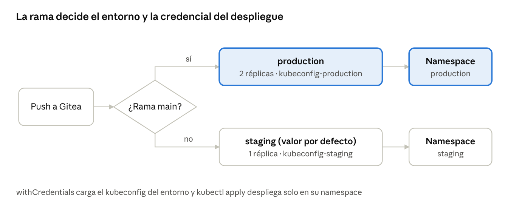

[← Sesión 6](sesion6.md) · [Índice de la UT02](./) · [Sesión 8 →](sesion8.md)

# Módulo 5168 Definición de flujos de procesos de despliegue continuo · Sesión 7 — Múltiples entornos y credenciales (Jenkins)

UT02, sesión 7 del módulo 5168: el mismo Jenkinsfile despliega en staging desde cualquier rama de feature y en production solo desde main, usando en cada caso su propia credencial.

## Ficha de la sesión

| Dato                   | Detalle                                                                                            |
|------------------------|----------------------------------------------------------------------------------------------------|
| Criterio de evaluación | RA2.b (continuación de la sesión anterior); redacción oficial según tu programación                |
| Lugar y equipo         | Aula, VM de VirtualBox (.ova) de cada alumno con Docker, Gitea, Jenkins y Minikube ya montados     |
| Entregable             | Capturas y Jenkinsfile en el repositorio de Gitea del alumno, más un breve cuestionario en Aules   |

### Objetivos de aprendizaje

Al terminar la sesión, el alumnado será capaz de:

1.  Explicar por qué staging y production necesitan credenciales y parámetros distintos.

2.  Reconocer las credenciales del laboratorio en Jenkins (tipo y ID) y explicar cómo las recibe el pipeline sin exponerlas.

3.  Comprobar cómo el Jenkinsfile del laboratorio elige el entorno según la rama (staging o production) y qué parámetros cambia en cada uno.

4.  Comprobar con dos ejecuciones (rama de feature y main) que cada una usa los parámetros de su entorno.

5.  Reconocer qué malas prácticas filtran secretos en los logs.

### Requisitos previos

- El laboratorio de la UT01 en marcha: Gitea con el repositorio `modulo5168-lab`, Jenkins (imagen `jenkins-lab`, con `kubectl` y `ansible-playbook`) y Minikube.

- En Jenkins ya existen las credenciales `kubeconfig-aula` (*Secret file*), `registry-credentials` y `gitea-cred`. En esta sesión no se crean credenciales nuevas: se estudian las que hay.

- El `lab/Jenkinsfile` del repositorio ya contiene la selección de entorno y la configuración con Ansible (sesiones 5 y 6). Hoy se ve funcionar.

- El job **Multibranch Pipeline** se crea en la práctica. Es imprescindible: la condición `when { branch 'main' }` solo funciona en este tipo de job, porque en un Pipeline simple la variable `BRANCH_NAME` no existe.

### Preparación del profesor (antes de clase)

- Comprobar que Minikube está arrancado en alguna VM de muestra (`minikube status`) y que `modulo5168-demo` construye con éxito (solo ejecuta el calentamiento; el despliegue completo lo lanzarás tú en esta sesión).

- Comprobar que `lab/ansible/vars/staging.yml` y `production.yml` siguen con valores distintos (réplicas y nivel de log), porque son lo que el alumnado va a observar.

- Tener presente que en el laboratorio staging y production comparten el mismo clúster y el mismo espacio de nombres: se distinguen por la configuración, no por el destino. La práctica lo hace notar en el paso 5.

## Teoría ampliada

Idea clave para el alumnado: **el código de la aplicación no cambia entre entornos; cambian el destino y las credenciales para llegar a él**, y el pipeline debe elegirlos solo, sin que nadie edite el Jenkinsfile a mano.

### 1. Qué es un entorno de despliegue

Un entorno es un destino donde se ejecuta la aplicación con una configuración propia. Los más habituales son tres:

- **Desarrollo**: máquina del programador o entorno compartido de pruebas rápidas; se rompe a menudo y no importa.

- **Staging** (preproducción): copia lo más fiel posible de producción donde se valida la versión antes de publicarla.

- **Production**: lo que usan los usuarios reales; un error aquí tiene coste real.

Pregunta para abrir debate: *¿qué pasaría si una rama de feature a medio hacer se desplegara en producción porque alguien se equivocó de contexto de kubectl?* De ahí sale la motivación: el pipeline, y no la persona, decide el destino.

### 2. Qué cambia de un entorno a otro

| Elemento                      | Staging                                    | Production                                              |
|-------------------------------|--------------------------------------------|---------------------------------------------------------|
| Destino en Kubernetes         | Namespace o clúster staging                | Namespace o clúster production                          |
| Credencial de acceso          | kubeconfig con permisos solo sobre staging | kubeconfig distinto, con permisos solo sobre production |
| Número de réplicas y recursos | Pocos, ajustados                           | Los necesarios para la carga real                       |
| Datos y servicios externos    | Base de datos y claves de pruebas          | Base de datos y claves reales                           |
| Quién puede desplegar         | Cualquier rama validada                    | Solo main, con más controles                            |

Tres ideas que conviene dejar claras:

1.  **Misma imagen, distinta configuración.** La imagen que se probó en staging es la que se promociona; lo que cambia es la configuración inyectada (variables, ConfigMap, Secret).

2.  **Credenciales separadas por entorno.** Si staging y production comparten credencial, un fallo en una rama de feature puede tocar producción. Con credenciales distintas, el propio sistema impide el error.

3.  **Configuración fuera del código.** Ningún secreto vive en el repositorio ni en el Jenkinsfile: viven en Jenkins (o en un gestor de secretos) y el Jenkinsfile solo los referencia por su ID.

### 3. Gestión de credenciales en Jenkins

El **Credentials Store** de Jenkins guarda secretos cifrados. Se gestionan en *Manage Jenkins → Credentials*. Cada credencial tiene un **ID** (el nombre con el que el pipeline la referencia), una descripción y un ámbito.

Tipos más usados:

| Tipo                          | Para qué sirve                                                          | Ejemplo en este módulo                    |
|-------------------------------|-------------------------------------------------------------------------|-------------------------------------------|
| Username with password        | Usuario y contraseña                                                    | Registro de imágenes, acceso a Gitea      |
| Secret text                   | Un único valor (token, clave de API)                                    | Token de un servicio                      |
| **Secret file**               | Un fichero completo, que Jenkins entrega al pipeline como ruta temporal | **kubeconfig de staging y de production** |
| SSH Username with private key | Acceso por SSH                                                          | Despliegue en un servidor remoto          |
| Certificate                   | Certificado cliente                                                     | Acceso a un clúster que lo exija          |

**Ámbito (scope).** *Global* hace la credencial visible para todos los jobs; *System* la reserva para Jenkins mismo. Además, una credencial creada dentro de una **carpeta** solo la ven los jobs de esa carpeta: es la forma de que los pipelines de staging no puedan ni listar las credenciales de producción. En la práctica de hoy se usa el ámbito Global por sencillez, y se menciona la carpeta como mejora.

**Convención de nombres.** Un ID que lleve el entorno al final permite construirlo en el pipeline: kubeconfig-staging y kubeconfig-production. El ID no se puede cambiar después sin romper los Jenkinsfile que lo usan.

**Cómo llega la credencial al pipeline.** Hay dos formas, y conviene mostrar ambas:

```groovy
// Forma 1: directiva credentials() dentro de environment (ID literal)
environment {
    REGISTRY = credentials('registro-docker')   // crea REGISTRY, REGISTRY_USR y REGISTRY_PSW
}

// Forma 2: withCredentials, válida con un ID calculado en tiempo de ejecución
withCredentials([file(credentialsId: "kubeconfig-${env.TARGET_ENV}", variable: 'KUBECONFIG')]) {
    sh 'kubectl get pods'
}
```

Para elegir la credencial según el entorno se usa la forma 2, porque su credentialsId admite una cadena construida con TARGET_ENV. Fuera del bloque withCredentials, la variable KUBECONFIG no existe y el fichero temporal se borra.

**Protección en los logs.** Jenkins sustituye por \*\*\*\* el valor exacto de un secreto si aparece en la salida. No es una garantía absoluta: si el valor se transforma (por ejemplo, en base64) o se parte, ya no se enmascara. Por eso hay reglas:

- No imprimir secretos con echo ni con cat del fichero.

- Usar comillas simples en sh '...' para que sea el shell quien lea la variable, y no Groovy quien la interpole en el texto del comando.

- No activar set -x en scripts que manejan secretos.

### 4. Elegir el entorno según la rama

En un job **Multibranch**, Jenkins crea un pipeline por cada rama y define BRANCH_NAME. Sobre esa variable se apoya la condición when { branch 'main' }.



selección de entorno por rama · 1 decisión, 2 destinos

Una rama distinta de main sigue el camino de staging, que es el valor por defecto; solo main cambia a production y, con ello, a su credencial y a sus parámetros.

```groovy
pipeline {
    agent any
    environment {
        TARGET_ENV = "staging"          // valor por defecto: cualquier rama va a staging
    }
    stages {
        stage('Seleccionar entorno') {
            when { branch 'main' }
            steps { script { env.TARGET_ENV = "production" } }
        }
        stage('Desplegar') {
            steps {
                withCredentials([file(credentialsId: "kubeconfig-${env.TARGET_ENV}", variable: 'KUBECONFIG')]) {
                    sh 'kubectl apply -f k8s/ -n ${TARGET_ENV}'
                }
            }
        }
    }
}
```

Puntos a explicar sobre este código:

- El valor por defecto es el seguro: si algo falla al evaluar la rama, se queda en staging, nunca en production.

- Asignar a env.TARGET_ENV dentro de script modifica la variable de entorno para **todas las etapas siguientes**; una variable Groovy normal (def x) no sobrevive entre etapas.

- La etapa Seleccionar entorno se omite (aparece en gris) en las ramas que no son main.

> **En el laboratorio:** solo existe una credencial, `kubeconfig-aula`, y el Jenkinsfile la carga con `credentials('kubeconfig-aula')` (forma 1). Staging y production comparten clúster, así que lo que cambia entre ellos son los parámetros que genera Ansible. El código de arriba muestra el caso real de una empresa, con una credencial por entorno.

Variante equivalente y más corta, para comentar al final:

```groovy
environment {
    TARGET_ENV = "${env.BRANCH_NAME == 'main' ? 'production' : 'staging'}"
}
```

Ambas hacen lo mismo. La primera muestra con claridad el uso de when; la segunda concentra la decisión en una línea.

### 5. Cierre y errores típicos

- Usar un job Pipeline normal en lugar de Multibranch: when { branch } nunca se cumple.

- ID de credencial mal escrito: el pipeline falla con un error de credencial no encontrada, aunque exista otra parecida.

- Dejar el kubeconfig de producción con permisos de administrador del clúster completo.

- Escribir el secreto directamente en el Jenkinsfile "solo para probar" y subirlo a Gitea.

## Práctica guiada

El alumnado crea el job Multibranch, observa cómo el mismo `lab/Jenkinsfile` despliega en staging desde una rama de feature y en production desde `main`, y comprueba qué cambia en cada caso.

| Paso | Qué se hace                                   | Resultado                                              |
|------|-----------------------------------------------|--------------------------------------------------------|
| 0    | Mirar cómo está montado el laboratorio        | Se identifican los entornos y las credenciales         |
| 1    | Explorar las credenciales de Jenkins          | Se sabe qué hay y cómo las usa el pipeline             |
| 2    | Crear el job Multibranch                      | Jenkins detecta las ramas del repositorio              |
| 3    | Rama de feature hacia staging                 | ConfigMap con los parámetros de staging                |
| 4    | Rama main hacia production, con aprobación    | ConfigMap con los parámetros de production             |
| 5    | Experimento: credencial inexistente           | El pipeline falla antes de tocar el clúster            |

### Paso 0 · Mirar cómo está montado el laboratorio

No hay nada que instalar. Desde el repositorio clonado en la VM (si no lo tienes: `git clone http://localhost:3000/aula/modulo5168-lab.git`) mira los dos sitios donde se decide el entorno:

```bash
cd modulo5168-lab
grep -n -A8 "Seleccionar entorno" lab/Jenkinsfile
cat lab/ansible/vars/staging.yml lab/ansible/vars/production.yml
```

Anota qué hace la etapa *Seleccionar entorno* y en qué se diferencian los dos ficheros de variables. Es lo único que cambia entre entornos: la imagen y el código son los mismos.

### Paso 1 · Explorar las credenciales de Jenkins

1.  *Manage Jenkins → Credentials → System → Global credentials (unrestricted)*.

2.  Localiza `kubeconfig-aula`, `registry-credentials` y `gitea-cred`. Apunta el **Kind** de cada una.

3.  Abre `kubeconfig-aula` y pulsa *Update*: Jenkins muestra el nombre del fichero, nunca su contenido. Sal sin guardar.

4.  En `lab/Jenkinsfile` busca dónde se usan: `KUBECONFIG = credentials('kubeconfig-aula')` en `environment` y `withCredentials([usernamePassword(...)])` en la etapa de push.

Pregunta para el cuaderno: ¿por qué el Jenkinsfile, que está en Gitea y lo ve cualquiera, no contiene ningún secreto?

### Paso 2 · Crear el job Multibranch

1.  **New Item**, nombre `modulo5168-multibranch`, tipo **Multibranch Pipeline**. Si el job ya existe en tu Jenkins, ábrelo y revisa que coincide con los puntos siguientes.

2.  En **Branch Sources** elige **Git**, URL `http://gitea:3000/aula/modulo5168-lab.git` y la credencial `gitea-cred`.

3.  En **Build Configuration**, **Script Path**: `lab/Jenkinsfile`.

4.  En **Scan Multibranch Pipeline Triggers** marca **Periodically if not otherwise run**, con intervalo de 1 minuto.

5.  **Save**. Jenkins escanea el repositorio y crea un job por cada rama que tenga Jenkinsfile.

El webhook de la sesión 3 no dispara este tipo de job; por eso se usa el escaneo periódico (o el botón *Scan Repository Now*).

Crea ahora la rama de trabajo y súbela:

```bash
git switch -c feature/saludo
git push -u origin feature/saludo
```

Pulsa *Scan Repository Now*. Jenkins construye las ramas que descubre: `feature/saludo` avanza hasta el final, y `main` se queda detenida en *Aprobación de despliegue a producción*. **No la apruebes todavía**: la usarás en el paso 4.

### Paso 3 · Rama de feature hacia staging

1.  Abre el build de `feature/saludo` y entra en *Console Output*. Busca la línea `Entorno de destino: staging`.

2.  En la vista de etapas, *Aprobación de despliegue a producción* aparece omitida (en gris), porque la rama no es `main`.

3.  Cuando el build termine, comprueba los parámetros que Ansible ha dejado en el clúster:

```bash
kubectl get configmap modulo5168-config -o jsonpath='{.data}'
kubectl get deployment modulo5168-app
```

Debe aparecer `TARGET_ENV: staging`, `LOG_LEVEL: DEBUG` y una réplica.

### Paso 4 · Rama main hacia production

1.  Abre el build de `main` que está esperando y pulsa **Desplegar** en la aprobación. Esta es la parada manual que protege producción.

2.  Cuando termine, repite los comandos del paso 3. Ahora deben mostrar `TARGET_ENV: production`, `LOG_LEVEL: WARN` y dos réplicas.

3.  Mira la etapa *Validación automática completa*: la prueba de carga usa menos peticiones en production que en staging.

> **Observación:** staging y production han desplegado sobre el mismo Deployment `modulo5168-app`, así que el segundo despliegue ha sustituido al primero. Es una limitación del laboratorio, que solo tiene un clúster pequeño. En una empresa irían a espacios de nombres o clústeres distintos, cada uno con su credencial.

### Paso 5 · Experimento: una credencial que no existe

Objetivo: ver que el pipeline depende de credenciales por ID y que, si falta, falla antes de tocar el clúster.

1.  En `feature/saludo`, cambia en `lab/Jenkinsfile` `credentials('kubeconfig-aula')` por `credentials('kubeconfig-staging')` (un ID que no existe).

2.  Sube el cambio y deja que Jenkins construya la rama. Debe fallar con un error del tipo `Could not find credentials entry with ID 'kubeconfig-staging'`.

3.  Revierte el cambio (`git revert HEAD`) y súbelo de nuevo. El build vuelve a ponerse en verde.

Pregunta de cierre: *¿qué habría pasado si las credenciales de staging y production fueran el mismo kubeconfig de administrador en un clúster compartido?*

## Comprobación y errores frecuentes

### Resultado esperado en cada ejecución

| Rama                         | Aprobación a production | Línea en el log                  | ConfigMap resultante                         | Réplicas |
|------------------------------|-------------------------|----------------------------------|----------------------------------------------|----------|
| feature/saludo               | Omitida (gris)          | Entorno de destino: staging      | TARGET_ENV staging, LOG_LEVEL DEBUG          | 1        |
| main                         | Pide confirmación       | Entorno de destino: production   | TARGET_ENV production, LOG_LEVEL WARN        | 2        |
| feature con credencial falsa | Omitida (gris)          | Could not find credentials entry | Sin cambios: el build falla antes de desplegar | Las mismas |

El log nunca debe mostrar el contenido del kubeconfig ni ningún token.

### Qué pedir al alumnado para validar la práctica

1.  Captura de la pantalla de *Credentials* con `kubeconfig-aula` y las otras dos (sin mostrar contenido).

2.  Captura del log de `feature/saludo` con la línea de entorno y la etapa de aprobación omitida.

3.  Captura de la aprobación pendiente y del log de `main` con la línea de production.

4.  Salida de `kubectl get configmap modulo5168-config -o jsonpath='{.data}'` tras cada despliegue.

5.  Captura del error del paso 5 y del build que vuelve a pasar tras revertir.

### Errores frecuentes y solución

| Síntoma                                                           | Causa probable                                                     | Solución                                                                                           |
|-------------------------------------------------------------------|--------------------------------------------------------------------|----------------------------------------------------------------------------------------------------|
| BRANCH_NAME vacío o la etapa de main nunca se ejecuta             | El job es un Pipeline normal, no Multibranch                       | Crear un job *Multibranch Pipeline* con el repositorio de Gitea como origen                        |
| La rama main va a staging                                         | La rama principal se llama master                                  | Cambiar la condición a branch 'master' o renombrar la rama                                         |
| La rama nueva no aparece en Jenkins                               | Falta el *scan*                                                    | Pulsar *Scan Repository Now* o esperar el escaneo periódico                                        |
| «Jenkinsfile not found» en el escaneo                             | Script Path mal puesto                                             | Debe ser `lab/Jenkinsfile`                                                                         |
| Could not find credentials entry with ID '...'                    | ID mal escrito (o es el experimento del paso 5)                    | Revisar el ID letra por letra; el correcto es `kubeconfig-aula`                                    |
| Error de autenticación al escanear el repositorio                 | Falta la credencial de Gitea en el job                             | Elegir `gitea-cred` en *Branch Sources*                                                            |
| kubectl: connection refused                                       | Minikube parado                                                    | `minikube status` y, si hace falta, `minikube start`                                               |
| Los builds quedan en cola y no arrancan                           | Solo hay 2 ejecutores y `main` parado en la aprobación ocupa uno; además se construyen todas las ramas del repositorio | Aprobar o abortar el build de `main`, o abortar builds de ramas que no uses                        |
| El build de main sigue «esperando»                                | La aprobación manual no se ha pulsado                              | Abrir el build y pulsar **Desplegar**                                                              |
| Aviso A secret was passed to sh using Groovy String interpolation | Se usó "..." en sh con una variable secreta                        | Cambiar a comillas simples y dejar que el shell lea la variable                                    |

## Entregable, evaluación y ampliaciones

### Entregable (propuesta)

Paquete en Aules con las capturas de la lista de validación y la URL del repositorio de Gitea. Plazo sugerido: antes de la siguiente sesión.

### Rúbrica orientativa

| Aspecto                  | Logrado                                                                           | En proceso                                                                            | No logrado                          |
|--------------------------|-----------------------------------------------------------------------------------|---------------------------------------------------------------------------------------|-------------------------------------|
| Credenciales             | Identifica las credenciales del laboratorio, su tipo, y explica por qué no hay secretos en el repositorio | Las localiza pero no explica cómo las recibe el pipeline | Secretos escritos en el Jenkinsfile |
| Selección de entorno     | La rama decide staging o production y el valor por defecto es staging             | Funciona en main pero el entorno se fija a mano en alguna etapa                       | Entorno fijo o elegido manualmente  |
| Credencial según entorno | Explica la diferencia entre `credentials()` y `withCredentials` y cuándo usar cada una | Describe solo una de las dos formas | No distingue ambas |
| Pruebas                  | Dos ejecuciones documentadas (feature y main) y el experimento del paso 5          | Una sola ejecución documentada                                                        | Sin evidencias                      |
| Seguridad en logs        | Comillas simples en sh, sin echo de secretos                                      | Algún aviso de interpolación de secretos                                              | Secretos visibles en el log         |

### Preguntas de repaso (para el cuestionario de Aules)

1.  ¿Por qué when { branch 'main' } no funciona en un job Pipeline normal?

2.  ¿Qué diferencia hay entre credentials('id') en environment y withCredentials? ¿Cuál usar si el ID se calcula en ejecución?

3.  ¿Por qué el valor por defecto de TARGET_ENV es staging y no production?

4.  Un compañero escribe sh "kubectl --token=\${TOKEN} ...". ¿Qué problema tiene?

5.  ¿Qué ventaja aporta guardar las credenciales de producción en una carpeta de Jenkins con acceso restringido?

### Ampliaciones opcionales (alumnado rápido o sesiones futuras)

- **Credenciales por carpeta**: mover los jobs a carpetas staging y production y crear cada credencial en la suya.

- **Un tercer entorno**: crear `lab/ansible/vars/pre.yml` con sus propios valores y una rama que lo seleccione en la etapa *Seleccionar entorno*.

- **Gestor de secretos externo**: comentar HashiCorp Vault o los *Secrets* de Kubernetes como alternativa al almacén de Jenkins.

---

[← Sesión 6](sesion6.md) · [Índice de la UT02](./) · [Sesión 8 →](sesion8.md)
